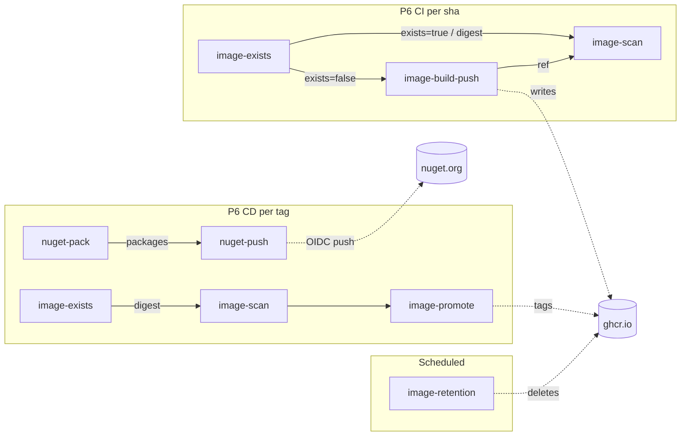

# Design: P5 ci-artifacts — artifact building blocks

**Spec ID:** 2026-11-22-ci-artifacts
**Requirements:** [requirements.md](./requirements.md)

## Overview

Seven composite actions under `actions/<block-name>/`. Each: `action.yml` (thin: input validation env wiring + steps), one shell script `<block-name>.sh` (all logic, shellcheck-able, no `${{ }}` inside), `README.md`. Blocks communicate only via inputs/outputs (R1.6). P6 composes them into CI (per sha) and CD (per tag) reusable workflows. `image-retention` runs on a schedule in caller or P6.

## Code Reuse Analysis

Repo is empty apart from spec scaffolding. Nothing in-repo to reuse. Reuse = runner-preinstalled tools + a minimal set of SHA-pinned upstream actions.

### Existing Components to Leverage

- **Runner tools (ubuntu-latest, preinstalled):** `docker` + `buildx`, `curl`, `jq`, `gh`, `unzip`, `dotnet` (caller still runs `setup-dotnet` for exact SDK). Used instead of extra installs.
- **`docker/setup-buildx-action`** (v3, SHA-pinned): `docker-container` builder, needed for `type=gha` cache export.
- **`docker/build-push-action`** (v6, SHA-pinned): build, push, labels, build args, gha cache, digest output. Avoids reimplementing buildx flag plumbing.
- **`NuGet/login`** (v1, SHA-pinned): OIDC → short-lived nuget.org key. Mandated by ruling.
- **`github/codeql-action/upload-sarif`** (v4, SHA-pinned): optional SARIF upload (R4.9).
- **`actions/cache`** (v4, SHA-pinned): Trivy DB cache.
- **Trivy CLI binary** (GitHub release tarball, version + sha256 pinned in `image-scan.sh`). Not `aquasecurity/trivy-action`: see D3.
- **GitHub Packages REST API** via `gh api` (`/orgs|users/{owner}/packages/container/{pkg}/versions`). Pagination built in.
- **OCI Distribution API** on `ghcr.io` via `curl` (token exchange, `HEAD`/`GET`/`PUT` manifests). Exact status codes, no layer transfer.

### Integration Points

- **GHCR (`ghcr.io/pernix-labs/*`)**: auth with `registry-token` (default `${{ github.token }}`) + `registry-username` (default `${{ github.actor }}`).
- **GitHub Packages API**: retention listing/deletion, self-test cleanup.
- **nuget.org**: `https://api.nuget.org/v3/index.json`, Trusted Publishing policy bound to caller `cd.yml` + environment `release`.
- **Code scanning**: SARIF upload, opt-in.
- **P4**: no shared files. P4 secret scanning will scan `tests/fixtures/`; secret fixture built so repo holds no matching literal (D9).

## Architecture

Pattern: thin `action.yml` + single script per block. `action.yml` maps `inputs.*` → `env:` (`INPUT_*`-style names like `IMAGE`, `TAG`), script reads env, writes `$GITHUB_OUTPUT` / `$GITHUB_STEP_SUMMARY`. Third-party actions are separate `uses:` steps in `action.yml`; scripts never call them.

Script conventions:
- `#!/usr/bin/env bash`, `set -euo pipefail`, never `set -x`.
- `validate` phase first: all inputs checked, `::error::` + `exit 1` before any network side effect (R1.7).
- Tokens: read from env, passed to `curl` via `-K -` config on stdin, to `docker login` via `--password-stdin`, to Trivy via `TRIVY_USERNAME`/`TRIVY_PASSWORD` env. Bearer tokens from exchange get `::add-mask::` immediately (R1.5).
- Multi-line outputs via `name<<EOF_<random>` delimiter.
- Image name check: `^ghcr\.io/[a-z0-9._-]+(/[a-z0-9._-]+)+$` (lowercase enforced, GHCR requires it) (R1.9).
- OCI manifest requests (`GET`/`HEAD`) send `Accept: application/vnd.oci.image.index.v1+json, application/vnd.oci.image.manifest.v1+json, application/vnd.docker.distribution.manifest.list.v2+json, application/vnd.docker.distribution.manifest.v2+json`.

**Owner rule (all GitHub Packages API calls):** `image-exists` 403 fallback, `image-retention`, self-test cleanup. Owner may be org or user. Resolve once per run: `GET /users/{owner}` → `.type == "Organization"` → base `/orgs/{owner}`, else `/users/{owner}`. Same token as registry calls (`registry-token`, as `GH_TOKEN` for `gh api`). Settings URL follows same split: `https://github.com/orgs/{owner}/packages/container/{pkg}/settings` or `https://github.com/users/{owner}/packages/container/{pkg}/settings`.

No shared script library (NFR modularity). OCI token exchange (~25 lines) duplicated in `image-exists.sh`, `image-promote.sh`, `image-retention.sh`. Accepted: each block stays standalone, no cross-block coupling, no `actions/_lib` dir colliding with P4's view of `actions/` (D2).



## Components and Interfaces

Common image inputs (R1.11): `registry-token` (default `${{ github.token }}`), `registry-username` (default `${{ github.actor }}`).

### image-exists

- **Purpose:** report whether `<image>:<tag>` manifest exists (R2).
- **Inputs:** `image` (req), `tag` (req), common.
- **Outputs:** `exists` (`true`|`false`), `digest` (`sha256:...` or empty).
- **Logic:**
  1. Token exchange `GET https://ghcr.io/token?service=ghcr.io&scope=repository:<path>:pull` (basic auth) → bearer.
  2. `HEAD /v2/<path>/manifests/<tag>` with 4-type `Accept`. `200` → `exists=true`, digest from `Docker-Content-Digest`. `404` (`MANIFEST_UNKNOWN` or `NAME_UNKNOWN`) → `exists=false`.
  3. `403` from token exchange or manifest `HEAD` ONLY (D13): resolve owner per owner rule, `GET {base}/packages/container/{name}` (`name` = image path after owner, URL-encoded). API `404` → `exists=false`, `digest` empty. API `200` → fail (package exists, token lacks access). Any other API code → fail.
  4. All other codes (`401`, `429`, `5xx`, unexpected) → fail (R2.4). One retry on `429`/`5xx` with 5s backoff, then fail.
- **Permissions:** `packages: read` (also covers Packages API fallback).
- **Dependencies:** `curl`, `jq`, `gh`.

### image-build-push

- **Purpose:** build + push `<image>:sha-<sha>` (R3).
- **Inputs:** `image` (req), `context` (default `.`), `dockerfile` (default `<context>/Dockerfile`), `sha` (default `${{ github.sha }}`), `version` (default empty), `build-args` (newline list), `platforms` (default `linux/amd64`), `cache` (default `true`), `source-url` (default `${{ github.server_url }}/${{ github.repository }}`), common.
- **Outputs:** `image`, `tag` (`sha-<sha>`), `digest`, `ref` (`<image>@<digest>`).
- **Steps:**
  1. `image-build-push.sh prepare`: validate (`sha` = 40 hex, `version` empty or SemVer 2.0), compute `tag`, effective version (`0.0.0-sha.<sha:0:7>` if empty), labels list, build-args list (`BUILD_VERSION`, `BUILD_COMMIT` appended after user args so they win), cache refs (`type=gha,scope=<image path>` / `type=gha,mode=max,scope=<image path>` or empty when `cache=false`). `docker login ghcr.io --password-stdin`.
  2. `docker/setup-buildx-action`.
  3. `docker/build-push-action` with `push: true`, `tags: <image>:sha-<sha>`, `labels`, `build-args`, `cache-from`/`cache-to`, `platforms`, `provenance: false`, `sbom: false` (D4).
  4. `image-build-push.sh outputs`: set outputs from step 3 `digest`.
- **Atomicity (R3.7):** single tag; push happens only after full build. No partial tags possible.
- **Permissions:** `packages: write`, `contents: read`.

### image-scan

- **Purpose:** Trivy vuln + secret scan of pushed ref; fail on threshold or any secret (R4).
- **Inputs:** `image-ref` (req; tag or digest ref), `fail-severities` (default `HIGH,CRITICAL`), `ignore-file` (default empty), `ignore-unfixed` (default `false`), `upload-sarif` (default `false`), `sarif-category` (default `image-scan`), common.
- **Outputs:** `critical-count`, `high-count`, `medium-count`, `low-count`, `secret-count`, `sarif-file`, `result` (`pass`|`fail`).
- **Steps:**
  1. `actions/cache` restore of `~/.cache/trivy/db` key `trivy-db-<UTC date>`.
  2. `image-scan.sh scan`: install pinned Trivy (download tarball, verify sha256, extract to `$RUNNER_TEMP`). Run once: `trivy image --scanners vuln,secret --format json --exit-code 0 --db-repository ghcr.io/aquasecurity/trivy-db,public.ecr.aws/aquasecurity/trivy-db` (+ `--ignorefile`, `--ignore-unfixed`). Non-zero Trivy exit (DB fetch fail, auth fail) → fail (R4.10). Strip secret material: `jq 'del(.Results[]?.Secrets[]?.Match, .Results[]?.Secrets[]?.Code)'`. `trivy convert --format sarif` on stripped JSON → `$RUNNER_TEMP/image-scan/results.sarif`. Counts via `jq`. Write summary (D5). Compute `result`; write outputs. Never exits non-zero for findings here.
  3. `github/codeql-action/upload-sarif`, `if: inputs.upload-sarif == 'true'`.
  4. `image-scan.sh enforce`: `result=fail` → `::error::` with counts, `exit 1`. Runs last so reports + upload always happen first (R4.2/4.3).
- **Fail rule:** fail IF `secret-count > 0` OR any vuln severity ∈ `fail-severities`. `MEDIUM`/`LOW`/`UNKNOWN` below threshold reported only.
- **Permissions:** `packages: read`; + `security-events: write` when `upload-sarif=true`.

### image-promote

- **Purpose:** add tags to existing manifest, same digest (R5).
- **Inputs:** `image` (req), `source-tag` (req), `tags` (req, newline list), `allow-overwrite` (default `false`), common.
- **Outputs:** `digest`, `tags` (newline list applied).
- **Logic (raw OCI, D6):**
  1. Validate every target tag against OCI tag grammar `^[A-Za-z0-9_][A-Za-z0-9_.-]{0,127}$`.
  2. Token exchange with `pull,push` scope.
  3. `GET` source manifest with 4-type `Accept` (raw bytes + `Content-Type` + digest). `404` → fail before any write (R5.3). 4-type `Accept` stops registry down-converting an index, so multi-arch indexes promote byte-identically.
  4. Per target: `HEAD` target (4-type `Accept`). Same digest → skip (R5.5). Different digest and `allow-overwrite=false` → fail (R5.4). All targets checked before first `PUT`.
  5. `PUT /v2/<path>/manifests/<target>` with identical bytes and `Content-Type` exactly as returned by step 3. Index children/blobs already in repo, so no blob transfer.
  6. `HEAD` each target, assert digest == source (R5.2).
- **Permissions:** `packages: write`.

### image-retention

- **Purpose:** delete expired GHCR versions (R6).
- **Inputs:** `packages` (req, newline list of package names, e.g. `my-svc`), `owner` (default `${{ github.repository_owner }}`), `max-age-days` (`14`), `prerelease-max-age-days` (`14`), `keep-versions` (`5`), `stable-tag-pattern`, `prerelease-tag-pattern` (defaults per R6.2), `dry-run` (`false`), `reference-time` (default empty = now; ISO 8601 UTC; D7), common.
- **Outputs:** `deleted-count`, `kept-count`, `deleted-versions` (JSON array `{package, id, tags}`).
- **Logic:**
  1. Resolve API base per owner rule.
  2. Per package: `gh api --paginate .../packages/container/<pkg>/versions?per_page=100`.
  3. Classify (stable > prerelease > sha-only) per R6.2 on `metadata.container.tags`.
  4. Mark deletions: stable beyond newest `keep-versions` by `created_at`; prerelease older than `prerelease-max-age-days`; sha-only older than `max-age-days`. Age = `reference-time - created_at`.
  5. Child protection (R6.6): for each retained version, `GET` its manifest (digest = version `name`) from registry; if index, collect `manifests[].digest`. Unmark any marked version whose digest is a child of a retained one.
  6. Last-version guard: GitHub API rejects deleting a package's last version. If marked set = all versions, keep newest one, `::notice::`.
  7. Unless `dry-run`: per marked version, re-`GET` version by id, re-classify (race with concurrent promote), then `DELETE`. On `403` at `DELETE`: `::error::` from `remediation_message` (D14), print deleted-so-far, write outputs, `exit 1`. On other API error: print deleted-so-far, write outputs, `exit 1` (R6.9).
  8. Summary table per package: kept/deleted, class, tags, age.
- **Permissions:** `packages: write`. `GITHUB_TOKEN` deletes versions only when caller repo has Admin on the package. Default for packages first pushed by that repo's workflow. Otherwise grant via package settings → "Manage Actions access" → this repo → Admin. README states precondition and steps.

### nuget-pack

- **Purpose:** `dotnet pack` projects at given version (R7).
- **Inputs:** `projects` (req, newline list of `.csproj`), `version` (req, SemVer 2.0, no `v`), `output-dir` (default `artifacts/nuget`), `configuration` (default `Release`).
- **Outputs:** `packages` (newline list `.nupkg`, no `.snupkg`), `package-count`, `output-dir` (absolute).
- **Logic:**
  1. Validate version with official SemVer 2.0 regex. Validate each project path exists.
  2. Fail if `output-dir` already contains `*.nupkg` (deterministic package list, D8).
  3. Per project: `dotnet pack <proj> -c <configuration> -o <out> -p:Version=<v> -p:PackageVersion=<v> -p:ContinuousIntegrationBuild=true`. Global props override `Directory.Build.props` and project `<Version>`/`<PackageVersion>`. `TreatWarningsAsErrors` untouched (R7.4).
  4. Collect `*.nupkg` excluding `*.snupkg`. Zero → fail. Per package: `unzip -p <pkg> '*.nuspec'`, extract `<version>`, mismatch → fail (R7.6).
- **Permissions:** `contents: read`. Caller runs `actions/setup-dotnet` (R7.7).

### nuget-push

- **Purpose:** push `.nupkg` to nuget.org via Trusted Publishing (R8). Composite, runs in caller job so OIDC `workflow_ref` = caller `cd.yml` and `environment` = `release` match the nuget.org policy (R8.1).
- **Inputs:** `packages` (req, glob or newline list), `user` (req unless `dry-run`), `skip-duplicate` (`true`), `dry-run` (`false`), `local-feed-dir` (default empty → `$RUNNER_TEMP/nuget-local-feed`). No API key input.
- **Outputs:** `pushed-count` (number of `.nupkg` processed successfully, incl. skipped duplicates).
- **Steps:**
  1. `nuget-push.sh resolve`: expand globs (`shopt -s globstar nullglob`), keep `.nupkg` only, zero → fail (R8.6). `user` empty and not dry-run → fail.
  2. `NuGet/login` (`id: login`, `if: inputs.dry-run != 'true'`, `with: user`). Outputs `NUGET_API_KEY` (masked by action).
  3. `nuget-push.sh push`: env `NUGET_API_KEY: ${{ steps.login.outputs.NUGET_API_KEY }}` (empty in dry-run). Real: `dotnet nuget push <pkg> --source https://api.nuget.org/v3/index.json --api-key "$NUGET_API_KEY" [--skip-duplicate]`; adjacent `.snupkg` pushed automatically by `dotnet`. Dry-run: `mkdir -p` feed, `dotnet nuget push <pkg> --source <feed> [--skip-duplicate]`, no `--api-key`. Key never written to file or output (R8.8). No `set -x`.
- **Permissions (caller job):** `id-token: write`, `contents: read`, `environment: release`. Dry-run needs neither.

## Data Models

### Block output contract (P6-facing)

```
image-exists      exists: "true"|"false", digest: "sha256:<64hex>"|""
image-build-push  image: ghcr.io/<owner>/<name>, tag: sha-<40hex>, digest: sha256:<64hex>, ref: <image>@<digest>
image-scan        critical-count|high-count|medium-count|low-count|secret-count: int, sarif-file: abs path, result: pass|fail
image-promote     digest: sha256:<64hex>, tags: newline list
image-retention   deleted-count: int, kept-count: int, deleted-versions: JSON [{package, id, tags[]}]
nuget-pack        packages: newline list abs .nupkg paths, package-count: int, output-dir: abs path
nuget-push        pushed-count: int
```

### Retention version record (internal)

```
package: string            # GHCR package name
id: int                    # GitHub package version id
digest: string             # version .name (sha256:...)
created_at: ISO 8601 UTC
tags: string[]             # metadata.container.tags
class: stable|prerelease|sha-only
action: keep|delete
reason: keep-n|age|child-of:<digest>|last-version
```

## Decisions

- **D1.** Thin `action.yml` + one script per block. Scripts are shellcheck targets and testable locally. Inline `run:` only for one-line glue.
- **D2.** No shared lib. OCI token-exchange duplicated in 3 scripts. Keeps blocks independent, avoids `actions/_lib` in shared `actions/` namespace.
- **D3.** Trivy CLI binary with pinned version + sha256, not `aquasecurity/trivy-action`. Fewer transitive actions, satisfies binary-checksum NFR, full control of JSON → stripped → SARIF pipeline. Single Trivy run, enforcement in later step.
- **D4.** `provenance: false`, `sbom: false` on build. NG6 excludes attestations. Single-platform builds stay a single manifest: smaller storage, simpler retention. Retention child protection still handles multi-arch indexes.
- **D5.** Step summary from Trivy JSON via `jq`: severity count table, separate secret line, top 20 findings (ID, pkg, severity, fixed version; secrets: rule ID + file path only).
- **D6.** Promote via raw OCI manifest `PUT`, not `docker buildx imagetools create`. Byte-identical manifest guarantees same digest. No extra tool (crane/oras) to install and pin.
- **D7.** `reference-time` input on retention. Enables deterministic self-test of age rules (versions seeded "now", evaluated at now+30d). Documented as test/backfill input.
- **D8.** `nuget-pack` requires empty `output-dir`. Output list = exactly this run's packages, no stale `.nupkg` leaking into push.
- **D9.** Secret fixture assembles secret-pattern string at build time from split build-arg fragments. Repo holds no matching literal, so P4 source secret scanning and GitHub push protection stay green.
- **D10.** Self-tests seed with plain `docker buildx build --push` / `curl`, not other blocks. Failure in one block's test isolates to that block.
- **D11.** Self-test images use per-run packages `pernix-ci-selftest-<block>-<run_id>-<run_attempt>`. Cleanup deletes the whole package (`DELETE {base}/packages/container/<pkg>`, base per owner rule), avoiding the last-version API rule and cross-run collisions.
- **D12.** `docker login` writes creds to `~/.docker/config.json` for the rest of the caller job. Accepted: ephemeral runner, same token caller already holds. README states it.
- **D13.** Narrow, foreman-approved amendment of R2.4. GHCR can return `403` instead of `404` for a never-created package. On `403` from token exchange or manifest `HEAD` only, `image-exists` confirms via Packages API `GET {base}/packages/container/{name}` with same `registry-token`. API `404` → `exists=false`. Anything else → fail. No other code is ever mapped to `false`. Permission unchanged (`packages: read`).
- **D14.** `image-retention.sh` builds the 403 remediation text in a pure function `remediation_message <owner-kind> <owner> <pkg> <repo>`, exposed as subcommand `image-retention.sh remediation-message`. Text: `Cannot delete versions of <pkg>: <repo> lacks Admin on the package. Open <settings URL> -> Manage Actions access -> grant <repo> Admin.` Lets self-test assert the message without a second repo.

## Error Handling

### Error Scenarios

1. **Invalid input** (bad image host, non-SemVer version, bad sha, bad tag): `::error::` naming input, exit before network. User sees failing step with input name.
2. **Registry auth failure on `image-exists`:** `401`/other → fail, never `exists=false`. `403` → Packages API check (D13): API `404` → `exists=false`; else fail. Message names image, registry status, API status.
3. **Registry 429 / 5xx:** one retry, 5s backoff, then fail.
4. **Trivy DB download failure:** both DB repos tried; then fail with `::error::` (R4.10). Never pass.
5. **Findings over threshold / any secret:** reports + optional SARIF upload complete, then `enforce` fails with counts.
6. **Promote source missing / target conflict:** fail before any `PUT`. Lists conflicting tags and digests.
7. **Promote digest mismatch after PUT:** fail with expected vs actual digest.
8. **Retention `403` at `DELETE`:** fail with D14 remediation `::error::` (settings URL, "Manage Actions access -> grant this repo Admin"). Deleted-so-far printed.
9. **Retention other API error mid-run:** stop, print deleted-so-far + outputs, fail.
10. **Retention race (version tagged between list and delete):** re-classify before delete, skip with `::notice::`.
11. **Pack version mismatch / zero packages:** fail naming project/package.
12. **Push: zero files matched:** fail. **OIDC/login failure** (missing `id-token: write`, policy mismatch): `NuGet/login` fails; README troubleshooting lists policy fields (owner, repo, `cd.yml`, `release`).
13. **Push duplicate:** `--skip-duplicate` → success. Without it → `dotnet` error fails step.

## Testing Strategy

### Unit Testing

- No unit framework. Each script gets local checks: `shellcheck actions/*/*.sh`, `actionlint .github/workflows/test-*.yml` (actionlint also lints composite `action.yml` usages from workflows).
- Input validation paths exercised in self-tests via `continue-on-error` + `steps.<id>.outcome == 'failure'` assertions.

### Integration Testing

One workflow per block, `.github/workflows/test-<block-name>.yml`, `on: pull_request` + `push: branches: [main]`, `permissions` minimal per job. Image jobs: `if: github.event_name == 'push' || !github.event.pull_request.head.repo.fork`, else a notice-only job (R9.10). Cleanup job/step `if: always()`.

| Block | Fixtures `tests/fixtures/<block>/` | Assertions |
|---|---|---|
| `image-exists` | `Dockerfile` (scratch + file) | `true` + digest after seed push; `false` for random tag in existing package; `false` + empty digest for never-created package `pernix-ci-selftest-image-exists-<run_id>-missing` (D13 path); failure on non-ghcr image input |
| `image-build-push` | `Dockerfile` with `ARG BUILD_VERSION BUILD_COMMIT` written to `/build-info` | tag = `sha-<sha>`; labels revision/version/source via `docker buildx imagetools inspect --raw` config; build-info content; second run hits cache |
| `image-scan` | `clean/Dockerfile` (scratch), `vulnerable/Dockerfile` (old base pinned by digest with known HIGH/CRITICAL CVEs), `secret/Dockerfile` (D9) | clean → `result=pass`; vulnerable → step failure + `high-count+critical-count>0`; secret → failure + `secret-count>0`; SARIF + summary contain no secret value |
| `image-promote` | `Dockerfile` (scratch + `COPY`, no `RUN`) | promote `sha-x` → `1.2.3`, `v1.2.3`; digests equal; re-run idempotent; conflicting tag fails without `allow-overwrite`; missing source fails; index built with `--platform linux/amd64,linux/arm64` promotes with equal digest and `mediaType` = OCI index (cheap: no `RUN`, so no QEMU needed) |
| `image-retention` | `Dockerfile` with `ARG SEED` label (distinct digests) | seed 7 stable, 2 prerelease, 3 sha-only; dry-run with `reference-time`=now+30d → plan deletes 2 oldest stable, both prerelease, all sha-only except child/last guards; prerelease not counted in keep-5; real-delete run on same per-run package → `deleted-count` matches plan (proves default Admin for run-created package); `image-retention.sh remediation-message` for org and user owner kinds → assert settings URL + "Manage Actions access" text (D14, automated) |
| `nuget-pack` | `Fixture.Lib/Fixture.Lib.csproj` (net8.0, `TreatWarningsAsErrors`), `Directory.Build.props` with `<Version>9.9.9</Version>` | `.nupkg` version = input `1.2.3-rc.1` (override proven); `package-count=1`; invalid `v1.2.3` fails; non-empty output-dir fails |
| `nuget-push` | `Fixture.Push/Fixture.Push.csproj` packed in-test with plain `dotnet pack` | `dry-run=true` → package in local feed, `pushed-count=1`; re-push with `skip-duplicate` succeeds; zero-match glob fails; job has no `id-token: write` |

### End-to-End Testing

- Real nuget.org Trusted Publishing path not exercised in this repo (G4). First real exercise = P6 caller `cd.yml`. README documents manual verification checklist.
- P6 composition validated in P6 spec.

## Risks

- **R1.** `GITHUB_TOKEN` package deletion (D11) relies on repo getting Admin on packages it creates (GitHub default). Real-delete self-test proves it. Fallback: org admin grants repo Admin via "Manage Actions access", escalated by implementing worker. Live 403 path not exercised automatically (needs second repo); message covered by D14 check.
- **R2.** Org package-creation settings may block private/public package creation by Actions. Org admin action (NG10).
- **R3.** Vulnerable fixture base image pulled from Docker Hub (rate limits, removal). Pinned by digest. Swap to another known-vuln base if removed.
- **R4.** Trivy secret rules may change across versions. Version pinned; secret fixture uses a pattern with long-stable built-in rule (GitHub PAT format).
- **R5.** Retention ordering by `created_at` reflects manifest push time, not tag time. Promoting an old sha image yields an "old" stable version. Acceptable under keep-N semantics; documented in README.
- **R6.** Resolved by D13. GHCR `403` for never-created package confirmed via Packages API `404` → `exists=false`. Self-test asserts it.
- **R7.** CD on a commit whose sha image was retention-deleted (>14d) gets `exists=false`. P6 must rebuild or fail; out of P5 scope.

## Links

- ADRs: none (NG4). Decisions D1–D14 above; P6 consolidates.
- Related specs: P4 ci-gates (parallel, shared repo conventions), P6 CI/CD workflows (consumer).
- Architecture docs: none in P5.
