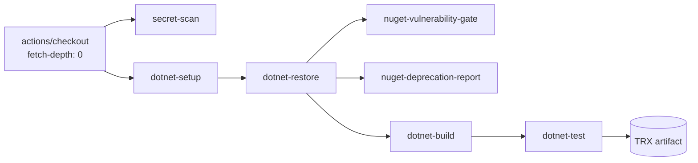
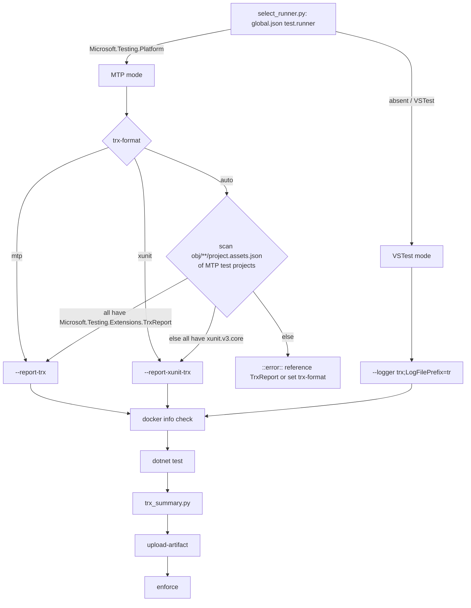

# Design: CI gates (P4)

**Spec ID:** 2026-11-22-ci-gates
**Requirements:** [requirements.md](./requirements.md)

## Overview

Seven composite actions under `actions/<block-name>/`, a shared helper dir, per-block self-test workflows, fixtures, root `README.md`, `.github/workflows/lint.yml`. Each block = thin `action.yml` → bash entry script (orchestration) → python3 stdlib helper (parsing + job summary rendering). Blocks never call each other. P6 composes them as steps in one job.

## Code Reuse Analysis

Repo is empty (LICENSE + spec scaffold). Reuse = upstream tools and first-party GitHub actions only.

### Existing Components to Leverage

- **`actions/setup-dotnet`** (SHA-pinned): SDK install from `global-json-file` + `dotnet-version`. Used by `dotnet-setup`.
- **`actions/cache`** (SHA-pinned): NuGet global packages cache. Used by `dotnet-restore`. Not `setup-dotnet` `cache:` (keys on `packages.lock.json` only; callers have no lockfiles, ruling Q4).
- **`actions/upload-artifact`** (SHA-pinned): TRX upload. Used by `dotnet-test`.
- **gitleaks CLI** (`gitleaks git`, `--redact`, `--report-format json`): binary from GitHub release, pinned version + SHA-256 constant in script (ruling Q3). Not `gitleaks/gitleaks-action` (org license).
- **`dotnet list package --format json --output-version 1`**: structured vulnerable/deprecated data. No custom NuGet API client.
- **MTP `--report-trx`** (`Microsoft.Testing.Extensions.TrxReport`) and **xunit.v3 native `--report-xunit-trx`**: TRX in MTP mode. **VSTest `--logger trx`**: TRX in VSTest mode.
- **MTP `--ignore-exit-code 8`**: tolerate per-module zero-test exit (explicit-only projects).
- **actionlint**, **shellcheck**: release binaries, pinned version + SHA-256.
- **Runner image tools**: `bash`, `git`, `python3` (stdlib only), `docker`, `curl`, `sha256sum`.

### Rejected reuse

- `dorny/test-reporter`, `EnricoMi/publish-unit-test-result-action`: need `checks: write`. Violates Req 1.5 (`contents: read` max). Own TRX → markdown renderer instead.
- `jq`: cannot parse TRX (XML) or `global.json` with comments. One parsing language (python3) instead of two.

### Integration Points

- **Caller checkout**: blocks read `GITHUB_WORKSPACE`. Caller supplies `actions/checkout` (`fetch-depth: 0` for `secret-scan`).
- **Caller MSBuild config**: `global.json`, `Directory.Build.props`, `Directory.Packages.props`, `nuget.config` read by SDK untouched (Req 1.11).
- **GitHub runtime**: `GITHUB_STEP_SUMMARY`, `GITHUB_OUTPUT`, `GITHUB_ENV`, `GITHUB_EVENT_PATH`, `::error::`/`::warning::` annotations.
- **P6**: consumes block outputs (table per block below) and `results-directory` files.

## Architecture

### Repo layout

```
actions/
  _shared/
    lib.sh                 # annotations, summary append, output write, arg-array helpers
    resolve_project.py     # project/solution auto-detect (Req 4.1 rule, reused by .NET blocks)
    globaljson.py          # JSONC-tolerant global.json reader
    md.py                  # markdown table escaping + truncation
  secret-scan/             action.yml README.md scan.sh report.py
  nuget-vulnerability-gate/ action.yml README.md gate.sh report.py
  nuget-deprecation-report/ action.yml README.md report.sh report.py
  dotnet-setup/            action.yml README.md detect.sh
  dotnet-restore/          action.yml README.md restore.sh
  dotnet-build/            action.yml README.md build.sh check_args.py
  dotnet-test/             action.yml README.md test.sh select_runner.py trx_summary.py
.github/workflows/
  lint.yml
  test-<block-name>.yml    # one per block
tests/
  fixtures/<block-name>/   # P4 blocks only
  unit/
    _shared/               # python unittest for actions/_shared helpers
    <block-name>/          # python unittest for that block's helpers (P4 blocks only)
README.md
```

`actions/_shared/` is P4-owned repo-wide code. Reachable at `${{ github.action_path }}/../_shared/` because `uses: Pernix-Labs/pernix-ci/actions/<block>@<ref>` downloads whole repo at `<ref>`. P5 may read, not edit.

### Block rules (all blocks)

- **R-injection.** `action.yml` never interpolates `${{ inputs.* }}` into `run:` text. Inputs pass via step `env:` (`INPUT_*`), scripts read env. Prevents script injection from caller-controlled strings.
- **R-oneliner.** `run:` holds one command (`"${{ github.action_path }}/<entry>.sh"`). Logic lives in `.sh` (shellcheck) / `.py` (Req 1.8).
- **R-strict.** `.sh`: `#!/usr/bin/env bash` + `set -euo pipefail`. `.py`: invoked `python3 -I`, stdlib only.
- **R-args.** Multi-arg inputs (`build-args`, `test-args`) are newline-separated, one arg per line, read into bash arrays (`mapfile`). No `eval`, no word-splitting of raw strings.
- **R-failclosed.** Any tool non-zero exit, parse error, or missing file → `::error::` + exit 1.
- **R-summary.** Summaries ≤ 200 table rows, cells ≤ 500 chars, `|` and newlines escaped (`md.py`). Overflow noted with row count.
- **R-noprops.** .NET blocks add no `-p:`/`-property:` switches of their own.

### Composition (P6 view)



`secret-scan` needs no SDK and may run in its own job. Vuln gate/deprecation report depend only on restore, so P6 can place them before build to fail fast.

## Components and Interfaces

### `actions/_shared`

- **`lib.sh`**: `error <msg>` (`::error::` + exit 1), `warn <msg>`, `set_output <k> <v>` (heredoc delimiter form for multi-line), `summary <file>` (append to `GITHUB_STEP_SUMMARY`).
- **`resolve_project.py <working-directory> [project]`**: `project` set → must exist (relative to `working-directory`) → print. Unset → top-level of `working-directory`: exactly one `*.slnx` → it; else exactly one `*.sln` → it; else exactly one `*.csproj` → it; else fail listing candidates and naming `project` input.
- **`globaljson.py <path> <key.path>`**: strips `//` and `/* */` comments outside strings and trailing commas, `json.loads`, prints value or empty. Parse error → exit 1.
- **`md.py`**: `table(headers, rows, limit=200)`, `cell(s, max=500)`.

### `secret-scan`

- **Purpose:** gitleaks over commit range (Req 3).
- **Inputs:** `scan-mode` (`auto`|`full-history`, default `auto`), `config-path` (default empty), `working-directory` (git repo root, default `.`), `gitleaks-version` not exposed (pinned in `scan.sh` with SHA-256).
- **Outputs:** `findings-count`.
- **Permissions:** `contents: read`.
- **Flow (`scan.sh`):**
  1. Download `gitleaks_<ver>_linux_x64.tar.gz` to `$RUNNER_TEMP`, `sha256sum -c` against constant, extract.
  2. Resolve range from `GITHUB_EVENT_NAME` + `GITHUB_EVENT_PATH`:

     | Event / mode | `--log-opts` |
     |---|---|
     | `full-history` | none (all refs) |
     | `pull_request`, `pull_request_target` | `<pull_request.base.sha>..<pull_request.head.sha>` |
     | `merge_group` | `<merge_group.base_sha>..<merge_group.head_sha>` |
     | `push`, `before` all-zero | `<github.sha>` (full reachable history) |
     | `push`, `before` present locally | `<before>..<github.sha>` |
     | `push`, `before` missing, repo not shallow | `<github.sha>` (force-push: old tip unreachable; superset scan) |
     | any other event | none (full history, fail-safe) |

  3. Shallow guard: `git rev-parse --is-shallow-repository` = `true` AND any range endpoint missing (`git cat-file -e <sha>^{commit}` fails) → `error "…set actions/checkout fetch-depth: 0"` (Req 3.4).
  4. Run `gitleaks git --redact --no-banner --exit-code 0 --report-format json --report-path $RUNNER_TEMP/gitleaks.json [--log-opts …] [--config <config-path>] <working-directory>`. `.gitleaks.toml` / `.gitleaksignore` at repo root auto-applied by gitleaks (Req 3.9). gitleaks exit ≠ 0 → tool error → fail.
  5. `report.py`: read JSON, emit per finding `::error file=<File>,line=<StartLine>::gitleaks <RuleID> in <Commit[:12]>`, summary table (rule, file, line, commit, fingerprint). Never reads `Secret`/`Match` fields. Count → `findings-count`.
  6. count > 0 → exit 1.
- **Report file** stays in `$RUNNER_TEMP`, not uploaded (redacted anyway, avoids exposure).

### `nuget-vulnerability-gate`

- **Purpose:** fail on high/critical, report moderate/low (Req 4).
- **Inputs:** `working-directory` (`.`), `project` (auto).
- **Outputs:** `critical-count`, `high-count`, `moderate-count`, `low-count`.
- **Permissions:** `contents: read`.
- **Flow (`gate.sh`):**
  1. `resolve_project.py`.
  2. `dotnet list "$PROJECT" package --vulnerable --include-transitive --format json --output-version 1 > $RUNNER_TEMP/vuln.json`. Capture exit + stderr.
  3. `report.py vuln`: JSON `problems[]` with `level == "error"` or text `No assets file` / `project.assets.json` → `error "…run dotnet-restore first"` (Req 4.2). Other errors / non-zero exit / bad JSON → fail (Req 4.7).
  4. Walk `projects[].frameworks[].{topLevelPackages,transitivePackages}[].vulnerabilities[]`. Row key = (`id`, `resolvedVersion`, `advisoryurl`). Aggregate TFMs, projects, `direct` = seen in any `topLevelPackages`. Severity normalized case-insensitive.
  5. Counts per severity over unique keys → outputs. Summary table sorted Critical→Low (Req 4.5). Each Critical/High row → `::error::`, Moderate/Low → `::warning::`.
  6. `critical-count + high-count > 0` → exit 1.
- **README** documents caller `Directory.Build.props` recommendation (Req 4.8):

  ```xml
  <PropertyGroup>
    <NuGetAuditMode>all</NuGetAuditMode>
    <NuGetAuditLevel>high</NuGetAuditLevel>
  </PropertyGroup>
  ```

  With `TreatWarningsAsErrors`, restore then fails only on NU1903/NU1904. Gate remains explicit report.

### `nuget-deprecation-report`

- **Purpose:** report deprecated packages (Req 5).
- **Inputs:** `working-directory`, `project`. **Outputs:** `deprecated-count`. **Permissions:** `contents: read`.
- **Flow (`report.sh`):** same shape as vuln gate with `--deprecated`. Key = (`id`, `resolvedVersion`). Columns: project(s), TFM(s), package, version, `deprecationReasons`, `alternativePackage.id` + `versionRange`, direct/transitive. `::warning::` per direct package (Req 5.3). Exit 0 unless tool error.

### `dotnet-setup`

- **Purpose:** install SDK(s) (Req 6).
- **Inputs:** `working-directory` (`.`), `global-json-file` (default `<working-directory>/global.json`), `dotnet-version` (multi-line, default empty).
- **Outputs:** `dotnet-version`.
- **Permissions:** `contents: read`.
- **Steps:**
  1. `detect.sh`: global.json path exists → output `global-json`. Absent AND `dotnet-version` empty → `error` naming both inputs (Req 6.2).
  2. `actions/setup-dotnet@<sha>` with `global-json-file: ${{ steps.detect.outputs.global-json }}`, `dotnet-version: ${{ inputs.dotnet-version }}`. Both may be set: global.json SDK + extra channels (e.g. `8.0.x` runtime for net8 test TFMs) (Req 6.3).
  3. `detect.sh --resolve`: `dotnet --version` in `working-directory` → `dotnet-version`. Writes `DOTNET_NOLOGO=1`, `DOTNET_CLI_TELEMETRY_OPTOUT=1` to `GITHUB_ENV`.

### `dotnet-restore`

- **Purpose:** restore + cache (Req 7).
- **Inputs:** `working-directory`, `project`, `locked-mode` (`false`).
- **Outputs:** `project` (resolved path), `cache-hit`.
- **Permissions:** `contents: read`.
- **Steps:**
  1. `actions/cache@<sha>`: `path: ~/.nuget/packages`, `key: nuget-${{ runner.os }}-${{ hashFiles(<wd>/**/Directory.Packages.props, <wd>/**/*.csproj, <wd>/**/packages.lock.json, <wd>/**/global.json, <wd>/**/nuget.config, <wd>/**/NuGet.Config) }}`, `restore-keys: nuget-${{ runner.os }}-`.
  2. `restore.sh`: `dotnet restore "$PROJECT" [--locked-mode]`. Nothing else (Req 7.4). Non-zero → fail.

### `dotnet-build`

- **Purpose:** Release build, caller strictness intact (Req 8).
- **Inputs:** `working-directory`, `project`, `configuration` (`Release`), `build-args` (newline list).
- **Outputs:** `project`.
- **Permissions:** `contents: read`.
- **Flow (`build.sh`):**
  1. `check_args.py`: reject any `build-args` element (case-insensitive) matching:
     - switch `-f`, `--framework`, `-warnaserror*`, `/warnaserror*`, `-warnnotaserror*`, `/warnnotaserror*`, `-nowarn*`, `/nowarn*`, `-warnasmessage*`, `/warnasmessage*`;
     - `-p:`/`/p:`/`-property:`/`/property:`/`--property:` whose `;`- or `,`-split assignments name `TargetFramework`, `TargetFrameworks`, `TreatWarningsAsErrors`, `MSBuildTreatWarningsAsErrors`, `CodeAnalysisTreatWarningsAsErrors`, `WarningsAsErrors`, `WarningsNotAsErrors`, `NoWarn`, `WarningLevel`, `NuGetAudit`, `NuGetAuditMode`, `NuGetAuditLevel`;
     - response file `@<path>` (opaque).
     Hit → `error` naming arg (Req 8.5).
  2. `dotnet build "$PROJECT" --configuration "$CONFIGURATION" --no-restore "${BUILD_ARGS[@]}"`.

### `dotnet-test`

- **Purpose:** run tests on VSTest or MTP, TRX + summary + artifact (Req 9).
- **Override of record:** TRX-format selection and the run-level zero-test rule below are approver fold-ins for design (no re-gate). This design supersedes Req 9.5 (MTP TRX only via `--report-trx`) and Req 9.15 (MTP exit code 8 → fail). requirements.md is not amended.
- **Inputs:**

  | Input | Default | Notes |
  |---|---|---|
  | `working-directory` | `.` | |
  | `project` | auto | |
  | `configuration` | `Release` | |
  | `global-json-file` | `<wd>/global.json` | runner detection |
  | `filter` | empty | VSTest: single `--filter` expression. MTP: newline list, one arg per line (`--filter-class` / `Pernix.*` on separate lines), same rule as `test-args` |
  | `test-args` | empty | newline list, appended last |
  | `trx-format` | `auto` | `auto` \| `mtp` (`--report-trx`) \| `xunit` (`--report-xunit-trx`). MTP only |
  | `min-tests` | `1` | min discovered tests summed over all TRX in run. `0` disables |
  | `results-directory` | `${{ runner.temp }}/test-results` | |
  | `upload-results` | `true` | |
  | `artifact-name` | `test-results` | must be unique per job/matrix leg (upload-artifact v4 rejects duplicates) |

- **Outputs:** `test-runner`, `trx-format`, `passed-count`, `failed-count`, `skipped-count`, `total-count`, `results-directory`.
- **Permissions:** `contents: read`.
- **Steps (composite):**
  1. `test.sh` — never fails the step except on pre-run errors (bad args, Docker down, TRX format unresolved). Writes `exit-code` output.
  2. `trx_summary.py` — `if: always()`. Parses TRX, writes summary + count outputs, writes `verdict` output.
  3. `actions/upload-artifact@<sha>` — `if: always() && inputs.upload-results == 'true'`, `path: <results-directory>/**/*.trx`, `if-no-files-found: warn`.
  4. `enforce.sh` — `if: always()`. Fails per verdict (Req 9.12, 9.15).

  Split guarantees summary + upload run on failure without composite `continue-on-error`.



- **Runner detection (`select_runner.py`, Req 9.1):** `globaljson.py <global-json-file> test.runner`. Equals `Microsoft.Testing.Platform` (ordinal-ignore-case) → `mtp`. Else `vstest`.
- **TRX format auto-detection (MTP only, approver fold-in):** test projects = `project.assets.json` files under `working-directory` matching `*/obj/*` whose `libraries` keys include `Microsoft.Testing.Platform/`. For that set:
  1. all contain `Microsoft.Testing.Extensions.TrxReport/` → `mtp` (`--report-trx`);
  2. else all contain `xunit.v3.core/` → `xunit` (`--report-xunit-trx`), no TrxReport needed (`pernix-outbox-relay` case);
  3. else → `error "MTP projects lack TRX support: reference Microsoft.Testing.Extensions.TrxReport or use xunit.v3, or set trx-format"`.
  Empty set → error "no MTP test projects found; restore first". Runs after restore, so assets exist.
- **Command lines:**
  - VSTest: `dotnet test "$PROJECT" --configuration "$CFG" --no-build --results-directory "$RD" --logger "trx;LogFilePrefix=tr" [--filter "$FILTER"] "${TEST_ARGS[@]}"`.
  - MTP (.NET 10 SDK `dotnet test` MTP mode): `dotnet test <--solution|--project> "$PROJECT" --configuration "$CFG" --no-build --results-directory "$RD" <--report-trx|--report-xunit-trx> --ignore-exit-code 8 "${FILTER_ARGS[@]}" "${TEST_ARGS[@]}"`. `--solution` for `.slnx`/`.sln`, `--project` for `.csproj`. `FILTER_ARGS` = `filter` read line-by-line via `mapfile` (empty lines dropped), no word-splitting (R-args). VSTest passes `filter` unsplit as one `--filter` value.
- **Docker check (Req 9.9):** `timeout 30 docker info >/dev/null` before run, both modes. Failure → `error "Docker daemon unreachable; Testcontainers requires Docker on the runner"`.
- **Zero-test rule (approver fold-in):**
  - Per project zero tests never fails (MTP `--ignore-exit-code 8`, VSTest tolerates). Covers explicit-only/skipped-by-default projects (`pernix-outbox-relay` `[Explicit]` allocation tests).
  - Run fails when: zero `*.trx` in `results-directory`, OR `total-count` (sum of `ResultSummary/Counters@total` = discovered incl. not-executed/skipped) < `min-tests`.
- **`trx_summary.py` (Req 9.11, 9.14):** parse every `*.trx` (namespace `http://microsoft.com/schemas/VisualStudio/TeamTest/2010`; same schema from VSTest, TrxReport, xunit native). Counters: `passed` = `passed`; `failed` = `failed + error + timeout + aborted`; `total` = `total`; `skipped` = `total − passed − failed`. Duration = max `Times@finish` − min `Times@start`. Failed table: `UnitTestResult[@outcome="Failed"|"Error"|"Timeout"|"Aborted"]` → test name, TRX file stem, `Output/ErrorInfo/Message` (truncated 500). First 200 rows.
- **Verdict (`enforce.sh`):** fail if `exit-code ≠ 0`, OR `failed-count > 0`, OR no TRX, OR `total-count < min-tests`. Message states which. Non-zero exit with zero failures → "test host exited <code>, see log".
- **Testcontainers env:** block sets none (Req 9.10).

### Self-test workflows

- Name `.github/workflows/test-<block-name>.yml`, `on: pull_request` + `push: branches: [main]`, top-level `permissions: contents: read`.
- Block referenced locally: `uses: ./actions/<block-name>`.
- Negative case pattern (Req 2.3):

  ```yaml
  - id: run
    uses: ./actions/<block-name>
    continue-on-error: true
    with: { … }
  - name: assert failed
    if: steps.run.outcome != 'failure'
    run: echo "::error::expected failure" && exit 1
  ```
- Python helper unit tests live in `tests/unit/<block-name>/test_*.py` (block helpers) and `tests/unit/_shared/test_*.py` (shared helpers). Each block self-test runs `python3 -I -m unittest discover -s tests/unit/<block-name>`, and every self-test of a block using `_shared` also runs `python3 -I -m unittest discover -s tests/unit/_shared`. P4 creates only `tests/unit/_shared/` and `tests/unit/<p4-block>/`, leaving `tests/unit/<p5-block>/` free for P5.

### `lint.yml`

- `on: pull_request` + `push: branches: [main]`, `permissions: contents: read`.
- Steps: checkout (SHA-pinned) → install shellcheck + actionlint release binaries (pinned version + SHA-256, `$RUNNER_TEMP/bin` on `PATH`) → `actionlint -color` (picks up pinned shellcheck for `run:` blocks) → `git ls-files -z '*.sh' | xargs -0 -r shellcheck`.
- Pinned shellcheck (not runner-preinstalled) keeps results stable across image updates.

### Root `README.md`

Sections: `# pernix-ci` (purpose) → `## Using a block` (`uses: Pernix-Labs/pernix-ci/actions/<block-name>@<sha|vX.Y.Z>`, checkout note) → `## Conventions` (Req 10.2 list) → `## Policy` (Req 10.6) → `## Gates` (catalogue table, links to block READMEs) → `## Artifacts` (placeholder: "Owned by P5 ci-artifacts.") → `## Workflows` (placeholder: "Owned by P6.") → `## Development` (lint, self-tests, fixtures).

## Data Models

### Block I/O summary

| Block | Inputs | Outputs |
|---|---|---|
| `secret-scan` | `scan-mode`, `config-path`, `working-directory` | `findings-count` |
| `nuget-vulnerability-gate` | `working-directory`, `project` | `critical-count`, `high-count`, `moderate-count`, `low-count` |
| `nuget-deprecation-report` | `working-directory`, `project` | `deprecated-count` |
| `dotnet-setup` | `working-directory`, `global-json-file`, `dotnet-version` | `dotnet-version` |
| `dotnet-restore` | `working-directory`, `project`, `locked-mode` | `project`, `cache-hit` |
| `dotnet-build` | `working-directory`, `project`, `configuration`, `build-args` | `project` |
| `dotnet-test` | see table above | `test-runner`, `trx-format`, `passed-count`, `failed-count`, `skipped-count`, `total-count`, `results-directory` |

### Fixtures (`tests/fixtures/<block-name>/`)

| Block | Fixture | Cases |
|---|---|---|
| `secret-scan` | `make-repo.sh` builds temp git repo at runtime; fake `ghp_` token assembled from random bytes (no literal committed) | pass: this repo's own range; fail: temp repo with token; allowlisted: temp repo + `.gitleaksignore` fingerprint → pass; shallow: `--depth 1` clone → fail |
| `nuget-vulnerability-gate` | `clean/`, `moderate/`, `high/` projects (`.slnx`); `json/*.json` recorded `dotnet list` outputs | clean pass; moderate pass + `moderate-count>0`; high fail; unrestored fail; unit tests on recorded JSON (incl. dedupe across TFMs, `problems[]`) |
| `nuget-deprecation-report` | `deprecated/` project; `json/*.json` | pass + `deprecated-count>0`; unit tests |
| `dotnet-setup` | `with-global-json/`, `no-global-json/` | global.json + `8.0.x` extra; version-only; neither → fail |
| `dotnet-restore` | `app/` (`.slnx`, CPM), `locked/` (`packages.lock.json`), `ambiguous/` (two `.slnx`) | pass; locked-mode pass; ambiguous fail |
| `dotnet-build` | `strict/` (`TreatWarningsAsErrors`, net8.0;net10.0), `strict-warning/` (same + code emitting CS warning) | pass; warning fail; `build-args: -p:NoWarn=CS0168` rejected |
| `dotnet-test` | `vstest/` (xunit.v3 + `xunit.runner.visualstudio`), `mtp-xunit/` (xunit.v3 MTP, no TrxReport, `global.json` `test.runner`, plus explicit-only project, plus one Testcontainers `alpine` test), `mtp-trxreport/` (MSTest MTP + TrxReport) | per fixture: pass; fail (env `FIXTURE_FORCE_FAIL=1`); filter narrowing; filter matching nothing → fail; `mtp-xunit` asserts `trx-format == xunit`, `mtp-trxreport` asserts `mtp` |

Vulnerable/deprecated fixture packages and their GHSA IDs chosen and recorded in fixture `README.md` at implementation. `high/` fixture sets `TreatWarningsAsErrors=false` so restore succeeds and the gate is what fails.

## Error Handling

### Error Scenarios

1. **Shallow clone, range missing (secret-scan).** Handling: fail before gitleaks. Impact: `::error::` "set `fetch-depth: 0`".
2. **Force-push, `before` unreachable.** Handling: scan full history of `github.sha`. Impact: slower scan, no false pass.
3. **gitleaks / dotnet / actionlint checksum mismatch.** Handling: fail before exec. Impact: `::error::` names tool + expected hash.
4. **Not restored (vuln/deprecation).** Handling: map `problems[]`/assets error. Impact: "run `dotnet-restore` first".
5. **`dotnet list` JSON unparseable or tool error.** Handling: fail closed. Impact: error + raw stderr tail (no secrets involved).
6. **Ambiguous / missing project.** Handling: `resolve_project.py` fails. Impact: lists candidates, names `project` input.
7. **Forbidden `build-args`.** Handling: fail before build. Impact: names offending arg + rule.
8. **Docker down.** Handling: fail before tests. Impact: Testcontainers message.
9. **MTP TRX unsupported.** Handling: fail before tests. Impact: remediation (TrxReport / xunit.v3 / `trx-format`).
10. **Zero TRX / total < `min-tests`.** Handling: `enforce.sh` fails after summary + upload. Impact: summary shows counts, error states rule.
11. **Test host crash (exit ≠ 0, failed = 0).** Handling: fail. Impact: "test host exited <code>".
12. **Duplicate `artifact-name`.** Handling: upload-artifact fails loudly. Impact: README tells P6 to suffix per leg.
13. **`global.json` unparseable.** Handling: fail. Impact: names file.

## Testing Strategy

### Unit Testing

- python `unittest` under `tests/unit/<block-name>/` and `tests/unit/_shared/`, discovered per directory (`-s tests/unit/<block-name>`). Covers `_shared/*.py`, `report.py` (vuln, deprecation, gitleaks), `check_args.py`, `select_runner.py`, `trx_summary.py`. Inputs: recorded JSON/TRX samples under `tests/fixtures/<block>/`. Key cases: dedupe, severity case, JSONC global.json, forbidden-arg matrix, TRX counters from VSTest/TrxReport/xunit-native samples, markdown escaping/truncation.

### Integration Testing

- Each `test-<block-name>.yml` runs block against live fixtures on `ubuntu-latest`, pass + fail paths (Req 2.3), asserts outputs.

### End-to-End Testing

- Out of P4 scope (P6 composes full pipeline). Manual smoke: README example pipeline run against `pernix-outbox-relay` branch before tagging `v0.1.0` (optional, not gating).

## Risks

- **R1.** `--vulnerable` fixtures depend on live nuget.org advisory data; advisory re-scoring can flip `moderate/` or `high/`. Mitigation: unit tests on recorded JSON are authoritative; live cases assert direction only (`high-count>0` / pass).
- **R2.** MTP `dotnet test` CLI is new (.NET 10). Flag drift breaks MTP mode. Mitigation: `mtp-*` fixtures pin SDK via fixture `global.json`.
- **R3.** TRX auto-detect relies on `obj/**/project.assets.json` layout. Custom `BaseIntermediateOutputPath` outside `working-directory` → detection fails loudly. Mitigation: `trx-format` override.
- **R4.** xunit.v3 explicit tests not run may be absent from TRX. `min-tests` is run-level, so only an all-explicit run fails; set `min-tests: 0` for that.

## Resolved questions

1. [x] **Q1.** Req 9.5 / 9.15 vs approver fold-ins. **Decided 2026-11-22:** fold-ins were binding "for design (no re-gate)". Design is override of record (see `dotnet-test` override note). No requirements amendment.

## Links

- ADRs: none yet.
- Related specs: P5 ci-artifacts (parallel), P6 reusable workflows (later).
- Architecture docs: none yet (closeout creates `docs/architecture/`).
