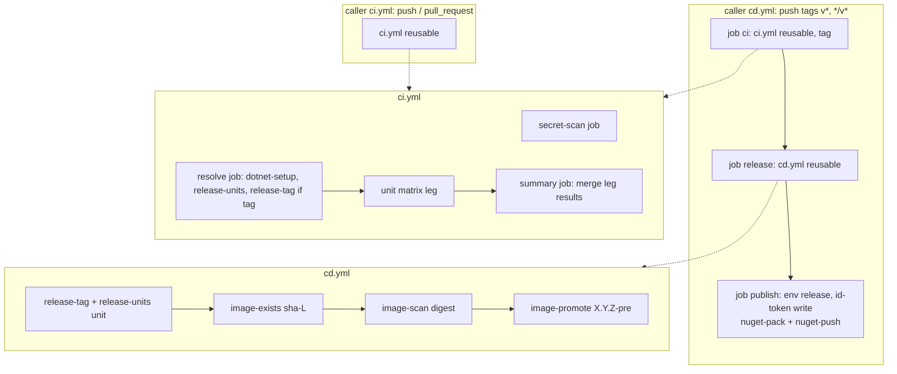
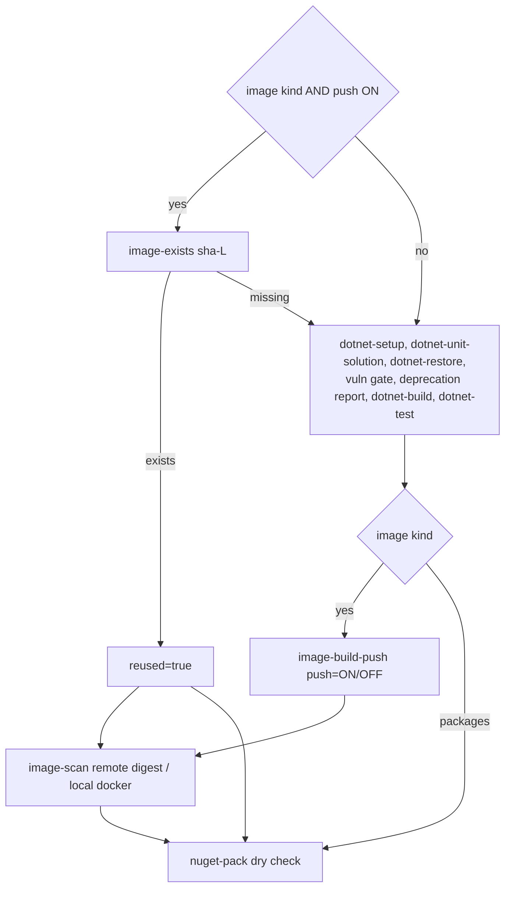

# Design: P6 ci-release-flow — tag-based CI/CD for .NET mono-repos

**Spec ID:** 2026-11-22-ci-release-flow
**Requirements:** [requirements.md](./requirements.md)

## Overview

Three new single-purpose blocks (`release-units`, `release-tag`, `dotnet-unit-solution`), three reusable workflows (`ci.yml`, `cd.yml`, `image-retention.yml`), caller templates under `templates/`, fixture mono-repo + self-tests, ADRs `docs/adr/0001`–`0013`, README `Artifacts` + `Workflows`. Reusable workflows only wire blocks. Logic lives in blocks.

Key resolutions:
- **R1** → reusable workflows check out pernix-ci at `${{ job.workflow_sha }}` into `pernix-ci/` and call blocks by local path `./pernix-ci/actions/<block>` (D1).
- **F4** → additive, default-preserving P5 amendment: `image-build-push` input `push`, `image-scan` input `image-source` (D9, Q1). Fallback without amendment listed in Q1.
- **Nested reusable call avoided** → caller `cd.yml` runs `ci` job (reusable CI with `tag`) before `release` job (reusable CD). CI reuses `sha-<L>` when present, so "CI only if image missing" holds in effect (D7, Q2).

## Code Reuse Analysis

### Existing Components to Leverage

- **P4 `dotnet-setup`, `dotnet-restore`, `dotnet-build`, `dotnet-test`, `nuget-vulnerability-gate`, `nuget-deprecation-report`**: unit leg gates, `project` = generated unit `.slnx`, `working-directory` = caller mono-repo root.
- **P4 `secret-scan`**: once per CI run, `auto` mode.
- **P5 `image-exists`**: reuse check on `sha-<L>` (CI push mode ON, CD).
- **P5 `image-build-push`**: build `sha-<L>` (`sha`=`L`, `version`=CI version). Push mode OFF via amendment D9.
- **P5 `image-scan`**: scan pushed digest (CI, CD rescan), local image via amendment D9.
- **P5 `image-promote`**: `sha-<L>` → `X.Y.Z[-pre]`.
- **P5 `image-retention`**: scheduled reusable workflow.
- **P5 `nuget-pack`**: CI dry check + caller publish job. **P5 `nuget-push`**: caller publish job only.
- **P4 `test-external-caller.yml`**: pattern (checkout under subdir) reused for reusable-workflow layout (D2) and extended with `@<sha>` job (Req 8.7).
- **P5 self-test patterns**: per-run selftest packages, `if: always()` cleanup, `leftover-check` job (P5 D11, AB2).
- **P4 unit-test layout**: `tests/unit/<block>/`, `python3 -I -m unittest`.
- **P4 lint**: `lint.yml` actionlint + shellcheck. Extended to `templates/*.yml` (Req 6.7).
- **Runner tools**: `git`, `jq`, `python3`, `docker buildx`.
- **`actions/checkout`, `actions/upload-artifact`, `actions/download-artifact`**: SHA-pinned, already used by P4/P5 (same pins).
- **mikefarah `yq` v4 binary**: YAML → JSON for matrix file. Version + SHA-256 pinned (P4 R1.4 pattern, like gitleaks). Python stdlib has no YAML parser.

Not reused: `actions/_shared` (P4-internal, guard stays P4-only, NFR).

### Integration Points

- **Caller repo**: `.github/release-units.yml`, `.slnx`, git history (`fetch-depth: 0`), tags.
- **GHCR** `ghcr.io/<owner>/<prefix><image>`: `sha-<L>` push (default-branch CI, CD), promote, retention.
- **nuget.org**: caller `cd.yml` job `publish`, environment `release`, OIDC via `nuget-push`.
- **GitHub job context**: `job.workflow_sha` (D1).

## Architecture

### Workspace layout (every reusable-workflow job)

```
$GITHUB_WORKSPACE/
  repo/        # caller repo at S or T (actions/checkout, path: repo)
  pernix-ci/   # Pernix-Labs/pernix-ci at job.workflow_sha (path: pernix-ci)
```

Blocks: `uses: ./pernix-ci/actions/<block>`, `working-directory: repo/<inputs.working-directory>`. Caller tree never contains pernix-ci files (no `**/*.csproj` cache-key or auto-detect pollution).

### Flow



### Unit leg (ci.yml `unit` job, one per matrix entry)



Reuse path for a unit with packages runs `dotnet-setup`, `dotnet-unit-solution`, `dotnet-restore` then `nuget-pack` only (Req 4.8). Gates skipped on reuse (Req 4.5).

### Push mode

`push` = `inputs.push-image == 'true'` OR (`inputs.push-image == 'auto'` AND (`inputs.tag != ''` OR (`github.event_name == 'push'` AND `github.ref == format('refs/heads/{0}', github.event.repository.default_branch)`))). Computed as expression in `resolve` job output. No script.

### Modular Design Principles

- One block = one concern: parse matrix + graph + last-touch (`release-units`), parse tag (`release-tag`), write unit solution (`dotnet-unit-solution`).
- Workflows: wiring + one-line `jq` glue only.
- Blocks python3 stdlib + thin bash entry, like P4 (D3). No `actions/_shared`.

## Components and Interfaces

### Block `release-units`

- **Purpose:** Req 1, Req 2. Validate matrix, resolve closure + inputs, compute `L`, emit units JSON.
- **Inputs:** `units-file` (`.github/release-units.yml`, relative to repo root), `working-directory` (`.`), `solution` (empty = auto-detect one `*.slnx`, else one `*.sln`, in `working-directory`), `unit` (empty = all), `owner` (`${{ github.repository_owner }}`), `image-name-prefix` (empty).
- **Outputs:** `units` (JSON array, Data Models), `unit-names` (newline list), `count`.
- **Requires:** SDK on PATH (`dotnet-setup` first), full history.
- **Logic (`release_units.py`, entry `release-units.sh`):**
  1. `git rev-parse --is-shallow-repository` = `true` → fail (`fetch-depth: 0`). Repo root `R` = `git rev-parse --show-toplevel`.
  2. `yq -o=json` matrix → JSON. Validate schema (D4): keys, name regex, uniqueness, `image`/`packages` presence, path existence (relative to `working-directory`). Unknown key → fail naming file/unit/key.
  3. Graph: per project `P` (BFS from roots `image.project` + `packages[]`): `dotnet msbuild P -getProperty:IsTestProject -getItem:ProjectReference` (JSON), follow `FullPath`. Memoised per project. Evaluates `Directory.Build.props/targets` injection (Req 2.2). No restore needed.
  4. Test projects: `dotnet sln <solution> list` → evaluate each project once (same call). `IsTestProject=true` AND reference closure (direct or transitive) → unit test project. Add test projects + their closure to unit closure.
  5. Inputs (paths relative to `R`, git pathspecs):
     - per closure project: `:(glob)<dir>/**`, plus excludes `:(exclude,glob)<dir>/**/bin/**`, `:(exclude,glob)<dir>/**/obj/**`.
     - per ancestor dir `A` of every closure project, up to `R`: `A/Directory.Build.props`, `A/Directory.Build.targets`, `A/Directory.Packages.props`, `A/global.json`, `:(icase)A/nuget.config`. Listed whether file exists or not (git log ignores absent paths, catches later additions).
     - image: `dockerfile`, `<context>/.dockerignore`.
     - `extra-inputs` verbatim (validated: relative, no `..` escape, no pathspec magic).
  6. `L` = `git log -1 --format=%H HEAD -- <pathspecs>`. Empty → fail (Req 2.7).
  7. `ci-version` = `0.0.0-ci.g<L[:7]>` (Req 3.8, D6).
  8. Filter by `unit` (unknown → fail). Write outputs + summary table (unit, kinds, `L`, inputs count, test projects).
- **Permissions:** `contents: read`.

### Block `release-tag`

- **Purpose:** Req 3. Tag → `unit`, `version`, `prerelease`, `commit`.
- **Inputs:** `tag` (req), `unit-names` (req, newline list from `release-units`), `default-branch` (`${{ github.event.repository.default_branch }}`), `commit` (empty; self-test override, D8), `working-directory` (`.`).
- **Outputs:** `unit`, `version`, `prerelease`, `commit`.
- **Logic (`release_tag.py`):**
  1. Regex `^(?:(?P<unit>[a-z0-9][a-z0-9-]*)/)?v(?P<ver>(0|[1-9]\d*)\.(0|[1-9]\d*)\.(0|[1-9]\d*)(?:-(?P<pre>(?:0|[1-9]\d*|\d*[A-Za-z-][0-9A-Za-z-]*)(?:\.(?:0|[1-9]\d*|\d*[A-Za-z-][0-9A-Za-z-]*))*))?)$` (SemVer 2.0 minus build metadata). `+` → explicit error "build metadata not allowed".
  2. Unit absent: allowed only when `unit-names` count = 1 → that unit. Else fail with expected form `<unit>/vX.Y.Z[-pre]`.
  3. Unit not in `unit-names` → fail listing known units.
  4. `commit` empty → `git rev-parse --verify "refs/tags/<tag>^{commit}"`. Given → must be 40 hex and exist. IF tag exists AND resolves elsewhere → fail.
  5. `git merge-base --is-ancestor <commit> origin/<default-branch>` false → fail (Req 3.5).
  6. Outputs + summary.
- **Permissions:** `contents: read`.

### Block `dotnet-unit-solution`

- **Purpose:** write one `.slnx` holding a unit's closure + test projects, so P4 blocks (single `project` input) gate exactly the unit (D5).
- **Inputs:** `projects` (req, newline list, relative to `working-directory`), `name` (req, `^[a-z0-9][a-z0-9-]*$`), `working-directory` (`.`).
- **Outputs:** `solution` (relative path `.pernix-ci-units/<name>.slnx`).
- **Logic:** fail if output exists. `dotnet new sln --format slnx -n <name> -o .pernix-ci-units`, `dotnet sln <file> add <projects…>`. Requires SDK ≥ 9.0.200 (slnx).
- **Permissions:** `contents: read`.

### P5 amendment (D9, Q1)

- `image-build-push`: new input `push` (default `true`). `false` → `docker/build-push-action` `push: false`, `load: true`. Outputs: `tag`, `image` as today, `digest` = local image id, `ref` = `<image>:sha-<sha>` (no `@digest`, nothing in registry). `docker login` skipped when `false`.
- `image-scan`: new input `image-source` (`remote` default | `docker`). `docker` → `--image-src docker`, `registry-token` unused. `IMAGE_REF_RE` unchanged (`ghcr.io/...:tag` local name).
- Defaults keep P5 behaviour byte-for-byte. Self-tests gain one case each (Req 8.4 local run covers composition).

### Reusable workflow `.github/workflows/ci.yml`

- **Trigger:** `workflow_call`.
- **Inputs:** `units-file`, `working-directory` (`.`), `sha` (empty → `github.event.pull_request.head.sha || github.sha`), `unit` (empty), `tag` (empty; CD use), `commit` (empty; self-test, D8), `default-branch` (empty → `github.event.repository.default_branch`; self-test only, D8), `push-image` (`auto`|`true`|`false`, default `auto`), `image-name-prefix` (empty; self-test per-run packages), `solution` (empty).
- **Outputs:** `units` (JSON `[{name, last-touch-sha, image-ref, reused}]`), `unit`, `version`, `commit` (when `tag` given).
- **Jobs:**
  1. `secret-scan` (`contents: read`): checkout `repo/` (fetch-depth 0, ref S), `secret-scan` `working-directory: repo`.
  2. `resolve` (`contents: read`): checkout `repo/` (fetch-depth 0, ref = `commit` if set, else `tag` if set, else S) + `pernix-ci/`; `dotnet-setup`; `release-units` (all units); IF `tag`: `release-tag` (`commit`, `default-branch` passed through), S := `release-tag` output `commit`, unit filter := tag unit; else unit filter := `inputs.unit`; select units (`jq` one-liner). Outputs: `units`, `push`, `sha`.
  3. `unit` (`contents: read`, `packages: write`; matrix `unit: fromJSON(needs.resolve.outputs.units)`, `fail-fast: false`): leg per Architecture. Ends with one-line `jq -n` writing `unit-result-<name>.json` → `upload-artifact` (`unit-result-<run_attempt>-<name>`).
  4. `summary` (`if: always()`): `download-artifact` pattern `unit-result-<run_attempt>-*`, `jq -s` merge → output `units` + job summary table. Fails if any leg failed (`needs.unit.result != 'success'`).
- First step of every job using blocks: checkout pernix-ci `repository: Pernix-Labs/pernix-ci`, `ref: ${{ job.workflow_sha }}`, `path: pernix-ci`, `persist-credentials: false`. Guard step before it: `job.workflow_sha` empty → `::error::` + exit 1 (D1).

### Reusable workflow `.github/workflows/cd.yml`

- **Inputs:** `tag` (empty → `github.ref_name`), `units-file`, `working-directory`, `commit` (self-test, D8), `default-branch` (empty → `github.event.repository.default_branch`; self-test only, D8), `image-name-prefix`, `solution`.
- **Outputs:** `unit`, `version`, `prerelease`, `commit`, `packages` (newline csproj list, relative to `working-directory`), `image-ref`, `image-tags`.
- **Jobs:**
  1. `resolve` (`contents: read`): checkout `repo/` ref `commit` if set, else `tag` (fetch-depth 0) + pernix-ci; `dotnet-setup`; `release-units`; `release-tag` (`commit`, `default-branch` passed through); select unit (`jq`).
  2. `promote` (`contents: read`, `packages: write`, `if:` unit has image): `image-exists` `sha-<L>` → `exists=false` → fail ("CI job must run first", D7). `image-scan` `<image>@<digest>`. `image-promote` `source-tag: sha-<L>`, `tags: <version>`. Outputs `image-ref`, `image-tags`.
  3. `outputs` (`if: always() && needs.resolve.result == 'success' && (needs.promote.result == 'success' || needs.promote.result == 'skipped')`): exposes workflow outputs. Allow-list, so `failure` and `cancelled` promote both block. Caller `publish` gated on it.
- No `id-token: write`, no NuGet (Req 5.6).

### Reusable workflow `.github/workflows/image-retention.yml`

- **Inputs:** `units-file`, `working-directory`, `dry-run` (`false`), `max-age-days` (`14`), `prerelease-max-age-days` (`14`), `keep-versions` (`5`), `image-name-prefix`.
- **Job** (`contents: read`, `packages: write`): checkout + pernix-ci, `dotnet-setup`, `release-units`, `jq` → `image-package` list, skip with notice if empty, `image-retention`.

### Templates `templates/`

- `ci.yml`: `on: push (branches: [main]), pull_request`; job `ci` `uses: Pernix-Labs/pernix-ci/.github/workflows/ci.yml@vX.Y.Z`, `permissions: contents: read, packages: write`.
- `cd.yml`: `on: push: tags: ['v*', '*/v*']`; `concurrency: cd-${{ github.ref }}`; jobs:
  - `ci`: reusable `ci.yml` with `tag: ${{ github.ref_name }}`.
  - `release`: `needs: ci`, reusable `cd.yml`.
  - `publish`: `needs: release`, `if: needs.release.outputs.packages != ''`, `environment: release`, `permissions: contents: read, id-token: write`; steps: `actions/checkout` ref `needs.release.outputs.commit`; `Pernix-Labs/pernix-ci/actions/dotnet-setup@vX.Y.Z`; `dotnet-restore`; `nuget-pack` (`projects`, `version` from `release`); `nuget-push` (`packages: ${{ steps.pack.outputs.packages }}`, `user: ${{ vars.NUGET_USER }}`).
  - Header comment: Trusted Publishing policy fields (owner, repo, workflow file `cd.yml`, environment `release`); file must stay `cd.yml`; why publish is not inside a reusable workflow.
- `retention.yml`: `on: schedule: cron '17 3 * * *'`, `workflow_dispatch` (`dry-run` boolean); reusable `image-retention.yml`.
- `release-units.yml`: commented example (image+packages unit `relay`, packages unit `client`).
- Lint: `lint.yml` actionlint target list adds `templates/*.yml` (actionlint accepts explicit paths).

## Data Models

### Matrix file `.github/release-units.yml`

```yaml
units:
  - name: relay                         # ^[a-z0-9][a-z0-9-]*$, unique, = tag prefix
    image:                              # optional
      project: src/Relay/Relay.csproj   # entry project
      dockerfile: src/Relay/Dockerfile
      context: .                        # optional, default "."
      name: pernix-outbox-relay         # optional, default unit name; GHCR package
    packages:                           # optional, non-empty
      - src/Core/Core.csproj
    extra-inputs:                       # optional pathspecs (Dockerfile COPY sources)
      - deploy/entrypoint.sh
```

Paths relative to `working-directory`. Top-level keys: `units` only.

### `release-units` output element

```json
{
  "name": "relay",
  "kinds": ["image", "packages"],
  "last-touch-sha": "<40hex>",
  "ci-version": "0.0.0-ci.g<7hex>",
  "image": "ghcr.io/pernix-labs/pernix-outbox-relay",
  "image-package": "pernix-outbox-relay",
  "image-project": "src/Relay/Relay.csproj",
  "dockerfile": "src/Relay/Dockerfile",
  "context": ".",
  "packages": ["src/Core/Core.csproj"],
  "packages-list": "src/Core/Core.csproj\n…",
  "projects": ["…closure incl. tests…"],
  "test-projects": ["tests/Relay.Tests/Relay.Tests.csproj"],
  "projects-list": "…newline…",
  "inputs": ["…pathspecs…"]
}
```

`*-list` fields duplicate arrays as newline strings so workflows feed block newline inputs without script glue.

### CI unit result

```json
{"name":"relay","last-touch-sha":"<40hex>","image-ref":"ghcr.io/…@sha256:…|","reused":"true|false"}
```

## Decisions

- **D1.** Self-pinning via `job.workflow_sha` (GitHub job context, Sep 2026 changelog): reusable workflow checks out pernix-ci at its own commit, calls blocks by local path. Rejected: OIDC `job_workflow_sha` claim (needs `id-token: write`, violates Req 5.6), caller-passed `pernix-ci-ref` (duplicated, unverifiable), literal pinned refs (cannot pin own PR commit, F3). Guard fails closed when empty (GHES, unsupported runner). Ruling RK1: first impl task verifies `job.workflow_sha` cross-repo with a real run. IF not populated THEN switch to caller-passed `pernix-ci-ref` input (reusable workflows check out pernix-ci at that ref; templates set it equal to the `uses:` ref) without re-asking, and record the switch in ADR 0012.
- **D2.** Two-dir workspace `repo/` + `pernix-ci/`. Isolates caller tree from pernix-ci files. Same pattern as P4 external-caller test.
- **D3.** Blocks = bash entry + python3 stdlib helper + pinned `yq`. Matches P4 style, unit-testable (Req 8.8).
- **D4.** Strict matrix schema, unknown keys fail. No `version-line` (ruling Q2).
- **D5.** Generated per-unit `.slnx` (`dotnet-unit-solution`). Lets P4 single-`project` blocks scope restore, vuln gate, build, test to unit closure without P4 change. Separate block keeps `release-units` single-purpose and SDK-write-free.
- **D6.** CI version `0.0.0-ci.g<sha7>` computed in `release-units` from `L`. Same value for image `BUILD_VERSION` and pack dry check.
- **D7.** No nested reusable-workflow call. Caller `cd.yml` chains `ci` → `release` → `publish`. CI reuses `sha-<L>` when present (rescan + pack dry check only), builds when missing. Reason: `uses: ./.github/workflows/…` inside a reusable workflow called cross-repo is not documented to resolve to pernix-ci at the same commit, and `owner/repo@ref` form cannot self-pin (D1). Reusable `cd.yml` fails if `sha-<L>` missing (CI skipped/edited out). Accepted by ruling Q2 as satisfying Req 5.3/5.4.
- **D8.** Self-test inputs `commit` + `default-branch` (`release-tag`, `ci.yml`, `cd.yml`), both documented "self-test only", callers leave empty. Ruling Q3: commit-override input chosen over pushing per-run tags (no `contents: write`).
  - `commit` lets self-tests use a synthetic tag without pushing tags (no `contents: write`). Tag string still fully parsed. When the tag exists it must match.
  - Reachability on PRs: `github.sha` on `pull_request` is the `refs/pull/N/merge` commit, never an ancestor of `origin/<default>`. Self-tests therefore pass `commit: ${{ github.event.pull_request.head.sha || github.sha }}` and `default-branch: ${{ github.head_ref || github.event.repository.default_branch }}`. PR run: PR head sha is ancestor of `origin/<head_ref>` (checkout `fetch-depth: 0` fetches base-repo branches; fork PRs skip registry jobs anyway, Req 8.9). Push to `main`: `head_ref` empty → default branch, `github.sha` on `main`.
  - Req 3.5 unchanged for callers: `release-tag` step 5 always runs `git merge-base --is-ancestor <commit> origin/<default-branch>`; only the branch name is supplied by the self-test. Negative path (commit off default branch → fail) covered by `test-release-tag.yml` scripted temp repo.
  - PR head sha holds the PR's own fixture changes, so reuse-vs-build and promote run on them.
  - No trust boundary crossed: caller owns its workflow file.
- **D9.** F4: additive P5 inputs `image-build-push.push`, `image-scan.image-source`, defaults unchanged. Approved by ruling Q1 (NG2 gate). Existing P5 self-tests (`test-image-build-push.yml`, `test-image-scan.yml`, all other `test-image-*.yml`) SHALL stay green unchanged; new cases only added.
- **D10.** Unit with zero test projects: `dotnet-test` skipped with `::notice::` (P4 `min-tests` would fail). Unit legs never invent tests.
- **D11.** Leg outputs via per-leg artifact + `summary` job merge. Matrix job outputs cannot carry per-leg values.
- **D12.** Promoted tag exactly `<version>` (no `v`). Retention `stable-tag-pattern` default `^v?…` matches.
- **D13.** Retention derives packages via `release-units` (full resolve). Daily cost ~1 min. No second YAML reader.
- **D14.** Concurrency: `cd.yml` template `concurrency: cd-${{ github.ref }}` (no cancel). CI: caller `concurrency: ci-${{ github.ref }}`, `cancel-in-progress` for PRs only.

## ADR plan (Req 9.1)

`docs/adr/NNNN-<slug>.md`, sections Status / Context / Decision / Consequences, Status `Accepted`, links to spec D-codes.

| ADR | Source | Topic |
|---|---|---|
| 0001 | P5 R1.10 | `sha-<40hex>` canonical commit tag |
| 0002 | P5 D6 | promote via raw OCI manifest `PUT` |
| 0003 | P5 D3 | Trivy CLI pinned binary over `trivy-action` |
| 0004 | P5 D2 | no shared lib for P5 blocks |
| 0005 | P5 R8.1 | `nuget-push` composite in caller job (Trusted Publishing) |
| 0006 | P5 R6.2 | retention classes stable / prerelease / sha-only |
| 0007 | P6 D4 | release-units matrix file |
| 0008 | P6 Req 2 | MSBuild graph + pathspec inputs + last-touch reuse |
| 0009 | P6 Q8 | PR CI local build + scan, push only default branch + CD |
| 0010 | P6 Req 3, D6 | tag grammar, tag-only version, CI version |
| 0011 | P6 D7 | CD split: reusable CI/CD + caller `publish` |
| 0012 | P6 D1, RK1 | self-pinning via `job.workflow_sha`; records verification run result and, if not populated, the switch to caller-passed `pernix-ci-ref` |
| 0013 | P6 D9, Q1 | additive P5 amendment `image-build-push.push` + `image-scan.image-source`, defaults unchanged |

## README

- `## Artifacts`: P5 table (block, purpose, link), like `## Gates`.
- `## Workflows`: flow overview (CI per sha, CD per tag), reusable workflow table (`ci.yml`, `cd.yml`, `image-retention.yml`: purpose, inputs link), new blocks table, caller setup checklist (matrix file, `fetch-depth` handled by workflows, environment `release`, nuget.org policy fields, `vars.NUGET_USER`, GHCR package Admin for retention, pin `vX.Y.Z`/sha), template links, F1 note (image `version` label = CI version), retention-deleted `sha-<L>` rebuilt by CD's `ci` job.
- `## Releases`: `v1.0.0` + moving `v1` (Req 10.3).

## Error Handling

1. **Shallow clone:** `release-units` fails, remediation `fetch-depth: 0`. Workflows always set it, so hits only direct block users.
2. **Matrix invalid:** fail before build, `::error file=<units-file>::unit <n>: key <k> …`.
3. **MSBuild evaluation error** (missing SDK, broken project): fail naming project, stderr tail. Remediation: run `dotnet-setup` first.
4. **Tag malformed / unknown unit / bare `v` in multi-unit / `+meta`:** `release-tag` fails with expected form and known units. CD stops before any write.
5. **Tag commit off default branch:** fail naming commit + branch.
6. **`job.workflow_sha` empty:** guard fails: "pernix-ci reusable workflows require github.com job.workflow_sha".
7. **`sha-<L>` missing in `cd.yml` `promote`:** fail "run ci job first (templates/cd.yml)".
8. **Scan fail on reuse/rescan:** CI/CD fails. Image stays. Fix = new commit (moves `L`) or advisory change / `.trivyignore`.
9. **Promote conflict** (version tag on other digest, e.g. re-tag after retention rebuild): `image-promote` fails (no `allow-overwrite`). Human resolves (new patch version).
10. **Publish duplicate:** `skip-duplicate` → success (Req 5.8).
11. **Leg failure:** `summary` fails, lists failed units. Other legs complete (`fail-fast: false`).
12. **Fork PR:** push mode OFF already, no registry calls. `packages: write` absent is irrelevant.

## Testing Strategy

### Unit Testing

- `tests/unit/release-units/`: schema validation matrix, pathspec construction (ancestors, icase, excludes), closure BFS on recorded `dotnet msbuild` JSON samples, test-project detection, `ci-version` (incl. all-digit sha → valid SemVer).
- `tests/unit/release-tag/`: grammar table (valid/invalid Req 8.3), single-unit bare `v`, `+meta` message.
- Run `python3 -I -m unittest discover -s tests/unit/<block>`.

### Integration Testing

| Workflow | Covers |
|---|---|
| `test-release-units.yml` | Req 8.2: copy `tests/fixtures/release-flow/repo` to temp dir, `git init`, scripted commits (`Shared`, service-only, `Directory.Packages.props`, unrelated, Dockerfile, test project, `extra-inputs`), run `./actions/release-units` after each, assert `L` per unit. Shallow clone → failure. |
| `test-release-tag.yml` | Req 8.3 against temp repo with real local tags + default branch; unreachable commit case via orphan branch. |
| `test-dotnet-unit-solution.yml` | slnx written, `dotnet build` on it builds only listed projects, existing output fails. |
| `test-release-ci.yml` | Req 8.4: `uses: ./.github/workflows/ci.yml` (same repo, same commit) with `working-directory: tests/fixtures/release-flow/repo`, S = default (PR head sha on PRs, so PR's own fixture changes are built then reused), `image-name-prefix: pernix-ci-selftest-release-flow-<run_id>-<run_attempt>-`, jobs `ci-build` (`push-image: true`, assert `reused=false`), `ci-reuse` (needs build, assert `reused=true`, same digest), `ci-local` (`push-image: false`, assert `image-ref` empty), `cleanup` (`if: always()`, delete per-run packages), `leftover-check`. |
| `test-release-cd.yml` | Req 8.5: `ci` (tag `svc/v0.0.1-selftest.<run_id>`, `commit: ${{ github.event.pull_request.head.sha \|\| github.sha }}`, `default-branch: ${{ github.head_ref \|\| github.event.repository.default_branch }}`, D8) → `release` (`cd.yml`, same tag/commit/default-branch) → reachability passes on PR head (ancestor of `origin/<head_ref>`) and on `main` → assert promoted tag digest = `sha-<L>` digest → `publish` job mirroring template with `nuget-push dry-run: true`, no `id-token: write` → cleanup + leftover-check. |
| `test-image-build-push.yml`, `test-image-scan.yml` | add `push: false` / `image-source: docker` cases (D9). |
| `test-external-caller.yml` | new job `external-caller-pinned`: same steps as existing job via `Pernix-Labs/pernix-ci/actions/<block>@377fbd2bab8e004aada51ae26be9b2432371c26b` (current `main` HEAD, Req 8.7). |
| `test-external-caller-v1.yml` | `workflow_dispatch` only, same steps `@v1`. Run at closeout after tagging (Req 8.7, 10). |
| `lint.yml` | actionlint covers `templates/*.yml`. |

Fork PRs: `test-release-ci.yml` / `test-release-cd.yml` registry jobs skip with notice (Req 8.9); `ci-local` runs.

Fixture `tests/fixtures/release-flow/repo/`: `global.json` (SDK 10, `test.runner` MTP), `Directory.Build.props` (`TreatWarningsAsErrors`), `Directory.Packages.props`, `Fixture.slnx`, `src/Shared`, `src/Svc` (+ `Dockerfile`, multi-stage `dotnet publish` → `mcr.microsoft.com/dotnet/runtime-deps` pinned by digest), `src/Lib`, `tests/Svc.Tests`, `tests/Lib.Tests` (xunit.v3 MTP), `deploy/svc.conf` (`extra-inputs`), `.github/release-units.yml` (units `svc` image, `lib` packages). Image must pass `image-scan` HIGH/CRITICAL (runtime-deps base, bumped digest if CVEs appear).

### End-to-End Testing

- Real nuget.org Trusted Publishing first exercised in P7 (`pernix-outbox-relay`).
- Closeout: run `test-external-caller-v1.yml` after `v1.0.0` + `v1` tags exist.

## Risks

- **RK1.** `job.workflow_sha` new (Sep 2026), single changelog source. First impl task verifies it cross-repo with a real run. IF not populated → switch to caller-passed `pernix-ci-ref` input without re-asking, record in ADR 0012 (ruling, D1).
- **RK2.** Fixture image may gain HIGH/CRITICAL CVEs over time → self-test red without code change. Mitigation: `runtime-deps` minimal base, digest bump.
- **RK3.** `dotnet sln add` on `.slnx` requires SDK ≥ 9.0.200. Callers on older SDK fail in `dotnet-unit-solution` with clear error.
- **RK4.** Promote conflict after retention rebuild (non-reproducible build, different digest) if the same version tag was pushed before. Low: version tags promote once.
- **RK5.** `dotnet msbuild -getItem` per project: O(projects) evaluations, ~1–2 s each. Fine for target repos (<30 projects).

## Resolved questions

Foreman rulings 2026-11-22.

1. [x] **Q1.** F4 P5 amendment (`image-build-push.push`, `image-scan.image-source`)? **Yes.** Additive inputs, defaults unchanged, P5 self-tests must stay green (D9, ADR 0013).
2. [x] **Q2.** Caller `cd.yml` always runs `ci` first, CI reuses `sha-<L>`? **Accepted** (D7).
3. [x] **Q3.** Self-test commit override vs per-run tag push? **Commit-override input** (D8).

## Links

- ADRs: `docs/adr/0001`–`0013` (created in this spec).
- Related specs: [P4 ci-gates](../2026-11-22-ci-gates/design.md), [P5 ci-artifacts](../2026-11-22-ci-artifacts/design.md), P7 pernix-outbox-relay onboarding (later).
- External: GitHub changelog 2026-09-03 (`job.workflow_sha`), GitHub reusable workflows reference.
